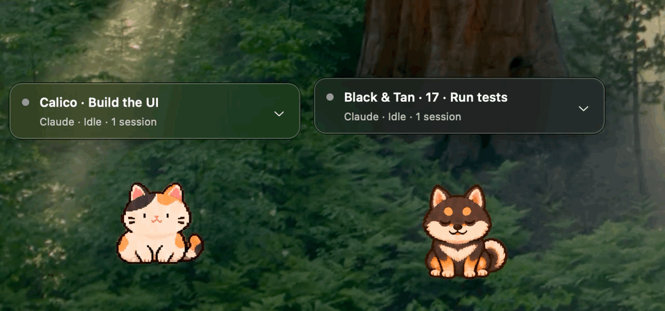
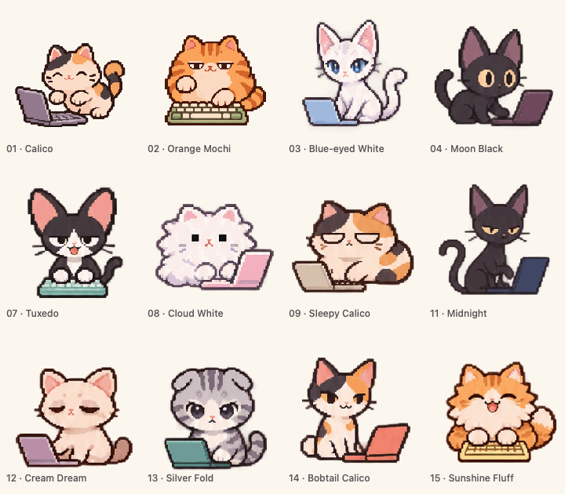
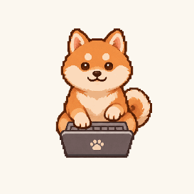
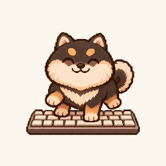
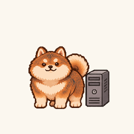
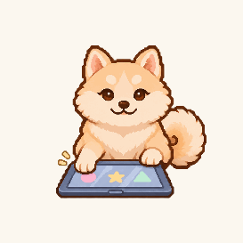

# Pet Lab

Pixel-art companions for your macOS desktop that follow Claude CLI sessions.



Recorded from the running macOS app with other app windows hidden, cropped to a desktop corner. Calico and Black & Tan · 17 are shown at 75% size, with their session cards cycling through simulated working, needs-input, and ready states.



## Meet the Shibas

Four new companions, each with all nine animations and a different idea of getting work done.

| Red · 16 | Black & Tan · 17 | Sesame · 18 | Cream · 19 |
| --- | --- | --- | --- |
|  |  |  |  |
| Laptop typing | Keyboard stompies | Computer mischief | Tablet tapping |

Choose one with `pet-lab pet 16` through `pet-lab pet 19`. [See all nine animations](docs/images/shiba-transitions.gif) or read the [Shiba pack guide](docs/shibas.md).

## Features

- Twelve original cat designs and four Shibas, each with nine animations.
- One shared companion, or a random pet per session with unused designs chosen first.
- Independent session activity and labels in multicats mode.
- Session cards above each cat: the chevron switches sessions, the arrow opens the session in the Claude desktop app (or on its own Terminal/iTerm2 tab for CLI sessions), right-click closes the cat, and dragging the card moves the cat.
- A menu-bar paw that opens Settings.
- Live pet sizing from 50% to 200%, idle wandering, and session-label controls.
- A saved multicats toggle; mode changes do not restart the monitor or renderer.
- Dragging, screen-edge clamping, idle naps, and keyboard/laptop working animations.

## Requirements

Apple Silicon Mac, macOS 13 or later, Node.js 22 or later, and Xcode command-line tools with Swift 5.9 or later. No third-party npm packages are required.

## Build and run

```sh
git clone https://github.com/lealbertta/pet-lab.git
cd pet-lab
npm run build:native
node bin/pet-lab.mjs
```

The default companion is Calico. To install the local command after building:

```sh
npm pack --offline --ignore-scripts
npm install --global --offline --ignore-scripts ./pet-lab-local-0.6.0.tgz
```

```sh
pet-lab                 # Start or reconnect
pet-lab settings        # Size, multicats mode, wandering, and session labels
pet-lab -multicats       # Enable one random cat per Claude session
pet-lab pets             # List all cats and Shibas
pet-lab pet 16           # Choose one shared companion
pet-lab status
pet-lab stop
```

Click the paw in the macOS menu bar to open Settings; right-click it for Settings and Quit. The icon remains available when multicats mode has no active sessions.

## Create more pets

Start with the [creator walkthrough](docs/creating-pets.md), [pack specification](docs/pet-packs.md), and [starter manifest](packs/starter/manifest.json). The [Calico pack](packs/cat-01-calico/manifest.json) demonstrates all nine animation states. Artwork prompts are in [docs/art-prompts](docs/art-prompts), and the original concept sheet is [here](docs/images/cat-concepts.png).

## Compatibility and privacy

Automatic discovery supports the Claude Code session registry from **2.1.311** through later 2.x releases, including Claude desktop app Code sessions. Records with an unrecognized format or status, or from Claude Code 3.0 and later, report uncertain status. Codex and Claude desktop Chat are not connected.

The app reads local session metadata and checks process identity. It does not read transcripts or prompts, edit Claude hooks, send telemetry, or make model/API calls. Runtime files live in `~/Library/Application Support/Pet Lab` with user-only permissions. Communication uses a local Unix socket.

The live registry supplies busy/idle activity, not explicit success/failure results or Claude's questions and approval requests. Those request cards are a design proposal, not an implemented live feed. Success/error animations require an explicit event source.

## Development

```sh
npm test
swift test --disable-sandbox --cache-path .build/cache --config-path .build/config --security-path .build/security
npm run build:native
node tools/verify-mode-toggle.mjs
```

The native integration checks use isolated fixture state and do not modify real Claude sessions. They require a macOS desktop session. Generated binaries, runtime state, screenshots, and test evidence are ignored by Git.

## Project status and artwork

This is a private, unsigned macOS development app. No open-source license has been selected. See [NOTICE.md](NOTICE.md) and each pack's artwork notice. The twelve cats and four Shibas are original ImageGen artwork; imported Alphonse and Pokémon assets, private migration history, and local activity evidence are intentionally absent from this repository.
