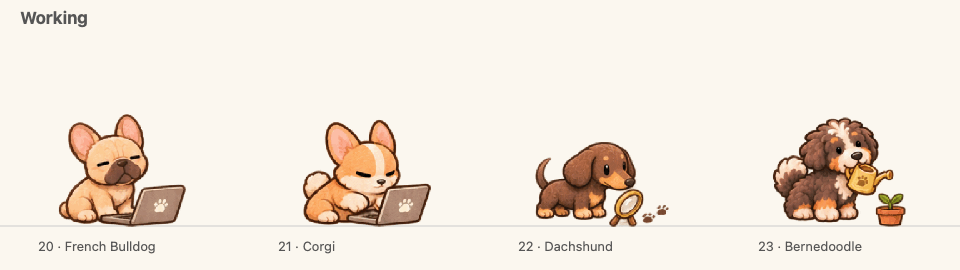

# Dog companions

Four dogs provide nine animation states, each with eight motion steps.



| Number | Companion | Working animation |
| --- | --- | --- |
| 20 | French Bulldog | Deliberate one-paw laptop typing |
| 21 | Corgi | Fast alternating keyboard paws, focused animal expression |
| 22 | Dachshund | Sniffing clues beside a magnifying glass |
| 23 | Bernedoodle | Nodding a watering can toward a potted seedling, with painted droplets |

Select them in the sprite picker or with `node bin/pet-lab.mjs pet 20` through `23`.

Each animation uses one fixed drawing with smooth, localized motion. Paws, ears, tails and breathing move through bounded deformation fields; the corgi's face and body, both laptops, the magnifying glass and the plant pot stay fixed during working. The corgi's success hop intentionally translates the body. Spawn and retire play once rather than looping.

The original artwork was generated with built-in OpenAI ImageGen. Generation prompts and original images are local under `artifacts/dogs/sources/`. Selected donor atlases and manifests are retained under `artifacts/dogs/rig-bases/`. Shipped animation PNGs, manifests and licenses are self-contained in `packs/dog-*`.

Rebuild the deterministic animations from the retained donor atlases:

```sh
swiftc -O -module-cache-path .build/preview-cache tools/animate-dog-rigs.swift -o .build/animate-dog-rigs
.build/animate-dog-rigs
```

Export previews and validate final assets:

```sh
swift -module-cache-path .build/preview-cache tools/preview-dogs.swift --working
swift -module-cache-path .build/preview-cache tools/preview-dogs.swift
node tools/verify-dogs.mjs
```

Verification checks clear cell boundaries for all 288 frames, pixel-identical working props, bounded adjacent-frame changes including loop seams, native validation and advancing visible working playback. The checks do not replace visual review. `artifacts/dogs/rig-animation-report.json` records selected donor drawings and frame deltas; `evidence/dog-library-check.json` records native playback results.

Previews use actual manifest frames and durations. Side-by-side GIFs are `artifacts/dogs/working.gif` and `transitions.gif`. Per-pack previews, including `all-animations.gif`, are exported by `tools/preview_pack.swift` under `artifacts/dogs/<pack>/`.
